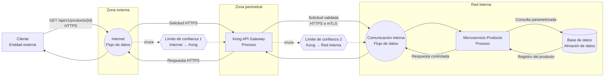

# ADR-001: Modelo de amenazas STRIDE para consulta pública de productos

- **Estado:** Propuesto
- **Fecha:** YYYY-MM-DD
- **Autores:** Equipo de Arquitectura / Seguridad / Productos
- **Decisores:** Por definir
- **Última revisión:** YYYY-MM-DD

## 1. Contexto

Se necesita documentar el modelo de amenazas del endpoint público encargado de obtener el detalle de un producto.

### Endpoint

```http
GET /api/v1/products/{id}
```

### Características

| Propiedad                | Descripción                                                                     |
| ------------------------ | ------------------------------------------------------------------------------- |
| Exposición               | Pública                                                                         |
| Propósito                | Obtener el detalle de un producto                                               |
| Parámetro de ruta        | `id`                                                                            |
| Formato de `id`          | UUID o entero, según el contrato definitivo                                     |
| Cuerpo de solicitud      | Ninguno                                                                         |
| Autenticación de cliente | No requerida                                                                    |
| Respuesta esperada       | Detalle público del producto                                                    |
| Componentes              | Cliente, Internet, Kong API Gateway, microservicio de productos y base de datos |

> **Decisión pendiente:** definir un único formato canónico para `id`. No se recomienda aceptar simultáneamente UUID y entero salvo que exista una necesidad funcional explícita.

## 2. Objetivo

Identificar amenazas utilizando STRIDE y establecer controles de seguridad para proteger:

- La disponibilidad del endpoint.
- La integridad de las solicitudes y respuestas.
- La confidencialidad de los datos no públicos.
- La trazabilidad de las operaciones.
- El microservicio y la base de datos frente a accesos no autorizados.
- La infraestructura interna frente a tráfico proveniente de Internet.

## 3. Alcance

### Incluido

- Solicitud HTTPS desde el cliente.
- Exposición del endpoint mediante Kong API Gateway.
- Comunicación entre Kong y el microservicio.
- Validación y procesamiento del identificador.
- Consulta del producto en la base de datos.
- Generación de la respuesta.
- Registro, monitoreo y limitación de tráfico.

### Fuera de alcance

- Creación, modificación o eliminación de productos.
- Administración del catálogo.
- Procesamiento de pagos.
- Gestión de inventario.
- Autenticación de usuarios para otros endpoints.
- Seguridad física de la infraestructura.
- Pipeline de despliegue y cadena de suministro de software.

## 4. Supuestos

1. El endpoint solo devuelve productos publicados y campos clasificados como públicos.
2. Los productos internos, borradores, deshabilitados o eliminados no deben ser accesibles.
3. La comunicación externa utiliza HTTPS.
4. La comunicación interna está autenticada y cifrada, preferentemente mediante mTLS.
5. Kong es el único punto autorizado para acceder al microservicio desde redes externas.
6. La base de datos no es accesible directamente desde Internet.
7. El microservicio utiliza consultas parametrizadas.
8. No se almacenan secretos, credenciales ni datos personales en logs.
9. La respuesta tiene un esquema explícito y no serializa directamente la entidad de base de datos.

## 5. Diagrama de Flujo de Datos

###### Warning: This code replicates Copyleft code owned by others outside of AT&T.Use of this code may require AT&T to publicly disclose the code and any other AT&T proprietary code used with it.

###### You should discard this code and prompt Ask AT&T to regenerate new code that does not contain Copyleft code.

###### If you choose to use this Copyleft code, you may do so only for internal operations, and must include in the code’s documentation: identification of the code’s original author(s) with copyright attribution ([year] © [author name]) and applicable license(s) (e.g., GPL family, Mozilla, Eclipse, CC BY-SA).

###### You cannot use Copyleft code for external distribution by any means. Click [HERE](https://att.sharepoint.com/:b:/s/TSS/EVYSBCbabyFEmFlbIOzSCyQB4IPvT2NQ1h4gO8LQ2HrBpQ?e=fV6dEw) for details.

###### Applicable license(s): GPL-3.0-only

###### Source URL(s): [https://github.com/nburmaso/upcgen](https://github.com/nburmaso/upcgen)



## 6. Elementos del modelo

| ID  | Elemento               | Tipo DFD            | Nivel de confianza    |
| --- | ---------------------- | ------------------- | --------------------- |
| E1  | Cliente                | Entidad externa     | No confiable          |
| F1  | Internet → Kong        | Flujo de datos      | No confiable          |
| P1  | Kong API Gateway       | Proceso             | Perimetral            |
| F2  | Kong → Microservicio   | Flujo de datos      | Confianza restringida |
| P2  | Microservicio Producto | Proceso             | Interno               |
| D1  | Base de datos          | Almacén de datos    | Interno restringido   |
| TB1 | Internet → Kong        | Límite de confianza | Externo/perimetral    |
| TB2 | Kong → red interna     | Límite de confianza | Perimetral/interno    |

## 7. Activos protegidos

| Activo                         | Requisito de seguridad                        |
| ------------------------------ | --------------------------------------------- |
| Datos públicos del producto    | Integridad y disponibilidad                   |
| Datos no públicos del producto | Confidencialidad                              |
| Base de datos                  | Confidencialidad, integridad y disponibilidad |
| Microservicio                  | Integridad y disponibilidad                   |
| API Gateway                    | Integridad y disponibilidad                   |
| Logs y métricas                | Integridad, confidencialidad y trazabilidad   |
| Credenciales entre servicios   | Confidencialidad e integridad                 |
| Configuración de Kong          | Integridad y acceso restringido               |
| Esquema de respuesta           | Integridad y minimización de datos            |

## 8. Clasificación de datos

La respuesta solo debe incluir campos explícitamente permitidos, por ejemplo:

```json
{
  "id": "7e0c2ce8-fabc-4f19-bde4-313e40ea1a91",
  "name": "Producto de ejemplo",
  "description": "Descripción pública",
  "price": 19.99,
  "currency": "USD",
  "availability": "AVAILABLE"
}
```

No deben exponerse, salvo justificación expresa:

- Costos internos.
- Márgenes comerciales.
- Identificadores internos innecesarios.
- Información del proveedor no pública.
- Estado de borrador.
- Metadatos de auditoría.
- Datos de usuarios o empleados.
- Claves, tokens o credenciales.
- Nombres de tablas, hosts o detalles de infraestructura.

## 9. Análisis STRIDE

### 9.1 Spoofing — Suplantación

| ID   | Amenaza                                                                             | Elemento | Impacto | Controles                                                                                                                          |
| ---- | ----------------------------------------------------------------------------------- | -------- | ------- | ---------------------------------------------------------------------------------------------------------------------------------- |
| S-01 | Un atacante intenta acceder directamente al microservicio evitando Kong.            | P2 / TB2 | Alto    | Segmentar la red, impedir exposición pública del microservicio, permitir tráfico únicamente desde Kong y aplicar políticas de red. |
| S-02 | Un sistema malicioso suplanta a Kong frente al microservicio.                       | F2 / P2  | Alto    | mTLS, identidad de carga de trabajo, validación de certificados y rotación de credenciales.                                        |
| S-03 | Suplantación del servicio de base de datos mediante DNS o configuración manipulada. | P2 / D1  | Alto    | TLS con validación del certificado, DNS interno seguro y configuración protegida.                                                  |
| S-04 | Un bot se presenta como cliente legítimo para realizar consultas masivas.           | E1 / P1  | Medio   | Rate limiting, detección de bots, cuotas por IP o cliente y protección ante abuso.                                                 |

**Consideración:** al ser un endpoint público, no se autentica al usuario final. Esto no elimina la necesidad de autenticar los componentes internos.

### 9.2 Tampering — Manipulación

| ID   | Amenaza                                                                           | Elemento | Impacto | Controles                                                                                    |
| ---- | --------------------------------------------------------------------------------- | -------- | ------- | -------------------------------------------------------------------------------------------- |
| T-01 | Manipulación del parámetro `id` para provocar inyección SQL o errores internos.   | F1 / P2  | Alto    | Validación estricta, consultas parametrizadas y rechazo temprano de formatos inválidos.      |
| T-02 | Alteración de la solicitud o respuesta en tránsito.                               | F1 / F2  | Alto    | TLS externo y mTLS o TLS interno.                                                            |
| T-03 | Manipulación de headers como `Host`, `X-Forwarded-For` o headers de enrutamiento. | P1 / P2  | Medio   | Kong debe eliminar o reconstruir headers confiables y utilizar una lista permitida.          |
| T-04 | Manipulación de la configuración de rutas o plugins de Kong.                      | P1       | Alto    | Control de acceso administrativo, gestión de cambios, auditoría y configuración como código. |
| T-05 | Modificación no autorizada de registros de productos.                             | D1       | Alto    | Usuario de base de datos de solo lectura para este flujo y mínimo privilegio.                |

### 9.3 Repudiation — Repudio

| ID   | Amenaza                                                                           | Elemento | Impacto | Controles                                                                                      |
| ---- | --------------------------------------------------------------------------------- | -------- | ------- | ---------------------------------------------------------------------------------------------- |
| R-01 | No es posible atribuir solicitudes abusivas a una fuente técnica.                 | P1       | Medio   | Registrar IP procesada de forma segura, timestamp, ruta, código de respuesta y request ID.     |
| R-02 | Kong y el microservicio generan registros que no pueden correlacionarse.          | P1 / P2  | Medio   | Propagar un `X-Request-ID` generado o validado por Kong.                                       |
| R-03 | Alteración o eliminación de logs para ocultar actividad.                          | P1 / P2  | Alto    | Almacenamiento centralizado, acceso restringido, retención definida y alertas de manipulación. |
| R-04 | Los logs no distinguen entre un identificador inválido y un producto inexistente. | P2       | Bajo    | Eventos estructurados y códigos internos de diagnóstico, sin revelar detalles al cliente.      |

### 9.4 Information Disclosure — Divulgación de información

| ID   | Amenaza                                                                           | Elemento | Impacto | Controles                                                                                               |
| ---- | --------------------------------------------------------------------------------- | -------- | ------- | ------------------------------------------------------------------------------------------------------- |
| I-01 | La respuesta expone campos internos o sensibles.                                  | P2       | Alto    | DTO de salida explícito, lista permitida de campos y pruebas de contrato.                               |
| I-02 | Se accede a productos no publicados cambiando el `id`.                            | P2 / D1  | Alto    | Consultar siempre por `id` y estado público, por ejemplo `published = true`.                            |
| I-03 | Mensajes de error revelan SQL, stack traces, nombres de tablas o infraestructura. | P2 / P1  | Medio   | Respuestas de error genéricas y detalles solo en logs protegidos.                                       |
| I-04 | La enumeración de identificadores enteros permite descubrir el catálogo completo. | F1 / P2  | Medio   | Preferir UUID no secuencial cuando la enumeración sea un riesgo; limitar tráfico y monitorear patrones. |
| I-05 | Diferencias entre `403`, `404` o tiempos de respuesta revelan productos internos. | P2       | Medio   | Usar una respuesta uniforme, normalmente `404`, para recursos inexistentes o no publicables.            |
| I-06 | Datos sensibles quedan registrados en logs, métricas o trazas.                    | P1 / P2  | Medio   | Enmascaramiento, minimización y prohibición de registrar respuestas completas.                          |
| I-07 | Cachés intermedias conservan respuestas incorrectamente.                          | P1       | Medio   | Definir `Cache-Control`, TTL, claves de caché y reglas de invalidación según la clasificación del dato. |

### 9.5 Denial of Service — Denegación de servicio

| ID   | Amenaza                                                            | Elemento | Impacto | Controles                                                                               |
| ---- | ------------------------------------------------------------------ | -------- | ------- | --------------------------------------------------------------------------------------- |
| D-01 | Alto volumen de solicitudes agota Kong o el microservicio.         | P1 / P2  | Alto    | Rate limiting, cuotas, escalamiento, protección DDoS y límites de conexión.             |
| D-02 | Consultas repetidas agotan el pool de conexiones de base de datos. | P2 / D1  | Alto    | Pool limitado, timeouts, caché, circuit breaker y backpressure.                         |
| D-03 | Un `id` de tamaño excesivo consume recursos de parsing o logging.  | P1 / P2  | Medio   | Límite de longitud y validación en Kong y en el microservicio.                          |
| D-04 | Clientes lentos mantienen conexiones abiertas.                     | P1       | Medio   | Timeouts de lectura, escritura e inactividad.                                           |
| D-05 | IDs aleatorios provocan gran cantidad de consultas sin resultados. | P2 / D1  | Medio   | Rate limiting, caché negativa con TTL controlado y monitoreo de tasas de `404`.         |
| D-06 | Fallos en la base de datos generan una cascada de reintentos.      | P2 / D1  | Alto    | Reintentos limitados con backoff y jitter, circuit breaker y presupuesto de reintentos. |

### 9.6 Elevation of Privilege — Elevación de privilegios

| ID   | Amenaza                                                                         | Elemento | Impacto | Controles                                                                                    |
| ---- | ------------------------------------------------------------------------------- | -------- | ------- | -------------------------------------------------------------------------------------------- |
| E-01 | Explotación del microservicio para ejecutar acciones con permisos de escritura. | P2 / D1  | Alto    | Credencial de base de datos de solo lectura y privilegios mínimos.                           |
| E-02 | Una ruta pública permite acceder accidentalmente a operaciones administrativas. | P1       | Alto    | Separar rutas públicas y administrativas, usar listas permitidas y pruebas de configuración. |
| E-03 | Compromiso de Kong permite movimiento lateral hacia la red interna.             | P1 / TB2 | Alto    | Segmentación, políticas de egreso, mínimo privilegio y autenticación servicio a servicio.    |
| E-04 | Vulnerabilidad en una dependencia permite ejecución remota.                     | P1 / P2  | Alto    | Gestión de vulnerabilidades, SBOM, actualización de dependencias y análisis de imágenes.     |
| E-05 | Uso de headers internos falsificados para adquirir privilegios.                 | F1 / P2  | Alto    | Eliminar headers internos enviados por el cliente y regenerarlos en Kong.                    |

## 10. Validación del parámetro `id`

Debe seleccionarse un formato único.

### Opción A: UUID

Ejemplo:

```http
GET /api/v1/products/7e0c2ce8-fabc-4f19-bde4-313e40ea1a91
```

Reglas:

- Aceptar únicamente UUID en el formato definido por el contrato.
- Longitud máxima esperada: 36 caracteres para representación canónica.
- Normalizar únicamente si el contrato lo permite.
- Rechazar valores adicionales, separadores inesperados o caracteres codificados.
- No concatenar el valor en consultas SQL.

### Opción B: entero

Ejemplo:

```http
GET /api/v1/products/12345
```

Reglas:

- Aceptar solo dígitos ASCII.
- Definir rango mínimo y máximo.
- Rechazar números negativos, decimales, notación científica y desbordamientos.
- Convertir mediante una función segura.
- Utilizar consultas parametrizadas.

### Recomendación

Preferir UUID no secuencial si los identificadores enteros facilitan una enumeración no deseada. Un UUID reduce la facilidad de enumeración, pero no sustituye controles de autorización, filtrado de estado, rate limiting o monitoreo.

## 11. Contrato de errores

| Escenario                          |             Código sugerido | Respuesta                                    |
| ---------------------------------- | --------------------------: | -------------------------------------------- |
| `id` con formato inválido          |           `400 Bad Request` | Mensaje genérico, sin detalles internos      |
| Producto inexistente               |             `404 Not Found` | Respuesta uniforme                           |
| Producto existente pero no público |             `404 Not Found` | Evita confirmar su existencia                |
| Límite de solicitudes excedido     |     `429 Too Many Requests` | Incluir `Retry-After` cuando corresponda     |
| Dependencia no disponible          |   `503 Service Unavailable` | Sin detalles de infraestructura              |
| Error inesperado                   | `500 Internal Server Error` | Incluir solo un identificador de correlación |

Ejemplo:

```json
{
  "code": "PRODUCT_NOT_FOUND",
  "message": "Product not found",
  "requestId": "01JEXAMPLE123456789"
}
```

## 12. Controles acordados

### Kong API Gateway

- Terminar TLS usando versiones y algoritmos aprobados.
- Aplicar rate limiting.
- Limitar longitud de URI y headers.
- Validar método HTTP y formato del path.
- Permitir únicamente `GET` para esta ruta.
- Rechazar cuerpos de solicitud innecesarios o limitar su tamaño.
- Eliminar headers internos proporcionados por el cliente.
- Generar o validar un identificador de correlación.
- Aplicar timeouts.
- Restringir el acceso al plano administrativo.
- Registrar metadatos de seguridad sin almacenar información sensible.
- Configurar CORS únicamente si el endpoint se consume desde navegadores y con orígenes justificados.

### Microservicio Producto

- Validar nuevamente el `id`; no confiar exclusivamente en Kong.
- Utilizar consultas parametrizadas.
- Consultar solo productos públicos.
- Usar DTOs explícitos para la respuesta.
- No serializar entidades de persistencia directamente.
- Aplicar timeouts, circuit breaker y límites de concurrencia.
- Ejecutarse con usuario sin privilegios.
- Mantener dependencias actualizadas.
- No devolver stack traces ni excepciones internas.
- Propagar el identificador de correlación.

### Base de datos

- No exponerla a Internet.
- Aceptar conexiones solo desde orígenes autorizados.
- Utilizar una cuenta específica de solo lectura.
- Aplicar mínimo privilegio a tablas, vistas y esquemas.
- Cifrar conexiones.
- Auditar accesos administrativos.
- Mantener backups y procedimientos de recuperación.
- Aplicar límites de conexiones y consultas.

## 13. Encabezados de seguridad y caché

La política dependerá de la sensibilidad y frecuencia de cambio del producto.

Ejemplo para contenido público cacheable:

```http
Cache-Control: public, max-age=60, s-maxage=300
Content-Type: application/json; charset=utf-8
X-Content-Type-Options: nosniff
```

Si la respuesta pudiera variar por contexto o incluir datos no públicos:

```http
Cache-Control: no-store
```

No debe habilitarse caché pública hasta verificar que:

- Todos los campos son públicos.
- La respuesta no depende de identidad o sesión.
- La clave de caché incluye correctamente la ruta y los parámetros relevantes.
- Existe una estrategia de invalidación o un TTL aceptable.

## 14. Monitoreo y alertas

Se deben generar métricas y alertas para:

- Incremento anormal de solicitudes por IP o cliente.
- Incremento de respuestas `400`, `404`, `429`, `500` y `503`.
- Latencia en percentiles p95 y p99.
- Saturación del pool de conexiones.
- Errores de conexión con la base de datos.
- Activación del circuit breaker.
- IDs consultados repetidamente.
- Enumeración secuencial de IDs.
- Cambios no autorizados en rutas o plugins de Kong.
- Intentos de acceso directo al microservicio.
- Fallos de autenticación mTLS entre servicios.

## 15. Pruebas de seguridad requeridas

- Pruebas con IDs inválidos y sobredimensionados.
- Pruebas de inyección SQL.
- Pruebas de encoding y doble encoding.
- Pruebas de enumeración.
- Pruebas de productos no publicados.
- Pruebas de contaminación de headers.
- Pruebas de acceso directo al microservicio.
- Pruebas de rate limiting.
- Pruebas de timeouts y agotamiento de conexiones.
- Pruebas para confirmar que no se exponen campos internos.
- Pruebas de errores para verificar que no se muestran stack traces.
- Pruebas de caché y de invalidación.
- Pruebas de correlación de logs entre Kong y el microservicio.

## 16. Riesgos residuales

| Riesgo                                              | Nivel residual | Tratamiento                                                             |
| --------------------------------------------------- | -------------- | ----------------------------------------------------------------------- |
| Consultas automatizadas a información pública       | Medio          | Aceptar con monitoreo, rate limiting y controles contra bots            |
| Enumeración si se usan IDs enteros                  | Medio          | Migrar a UUID o implementar controles adicionales                       |
| DDoS distribuido de gran escala                     | Medio/Alto     | Transferir parcialmente a proveedor anti-DDoS y escalar infraestructura |
| Exposición accidental de campos por cambios futuros | Medio          | Pruebas de contrato, revisión de código y DTO explícito                 |
| Dependencia de Kong como punto crítico              | Medio          | Alta disponibilidad, monitoreo y procedimientos de recuperación         |
| Datos públicos desactualizados en caché             | Bajo/Medio     | TTL e invalidación acordes con el negocio                               |

## 17. Decisión

Se decide:

1. Exponer el endpoint exclusivamente mediante Kong API Gateway.
2. Utilizar HTTPS para el tráfico externo.
3. Utilizar TLS autenticado o mTLS entre Kong y el microservicio.
4. Impedir el acceso directo desde Internet al microservicio y a la base de datos.
5. Validar el identificador tanto en Kong como en el microservicio.
6. Utilizar consultas parametrizadas y una cuenta de base de datos de solo lectura.
7. Retornar únicamente campos públicos mediante un DTO explícito.
8. Tratar los productos no publicados como inexistentes y responder `404`.
9. Aplicar rate limiting, timeouts, límites de conexión y monitoreo.
10. Definir un único formato canónico para `id` antes de implementar el contrato definitivo.
11. Mantener pruebas automatizadas para los controles principales del modelo STRIDE.

## 18. Consecuencias

### Positivas

- Se reduce la superficie de ataque.
- Se evita el acceso directo a componentes internos.
- Se limita el impacto de inyección SQL y abuso de recursos.
- Se mejora la trazabilidad mediante identificadores de correlación.
- Se reduce el riesgo de exposición accidental de datos internos.
- Se establecen responsabilidades claras entre Kong, el microservicio y la base de datos.

### Negativas

- Aumenta la complejidad de configuración y operación.
- mTLS requiere gestión del ciclo de vida de certificados.
- El rate limiting puede afectar clientes legítimos si se configura de forma incorrecta.
- La caché requiere políticas de expiración e invalidación.
- El monitoreo y la centralización de logs añaden costo operativo.

## 19. Criterios de aceptación

Este ADR podrá pasar a estado **Aceptado** cuando:

- [ ] Se haya elegido UUID o entero como formato único.
- [ ] El esquema de respuesta pública esté documentado.
- [ ] Kong aplique validación, rate limiting y timeouts.
- [ ] El microservicio no sea accesible desde Internet.
- [ ] La conexión interna esté cifrada y autenticada.
- [ ] La cuenta de base de datos sea de solo lectura.
- [ ] La consulta filtre productos no públicos.
- [ ] Existan pruebas de inyección, enumeración y divulgación de datos.
- [ ] Los logs estén correlacionados y no contengan datos sensibles.
- [ ] Se hayan definido dashboards y alertas.
- [ ] Seguridad y arquitectura hayan revisado el riesgo residual.

## 20. Referencias

- OWASP API Security Top 10.
- OWASP Application Security Verification Standard.
- Metodología STRIDE.
- Prácticas de modelado de amenazas para diagramas de flujo de datos.
- Estándares internos de API, logging, TLS y gestión de secretos.
